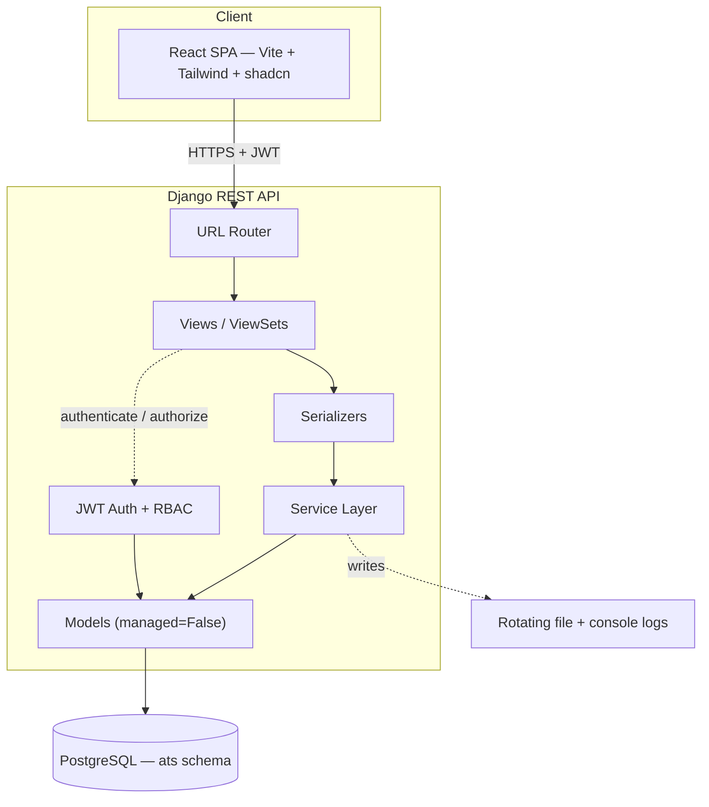
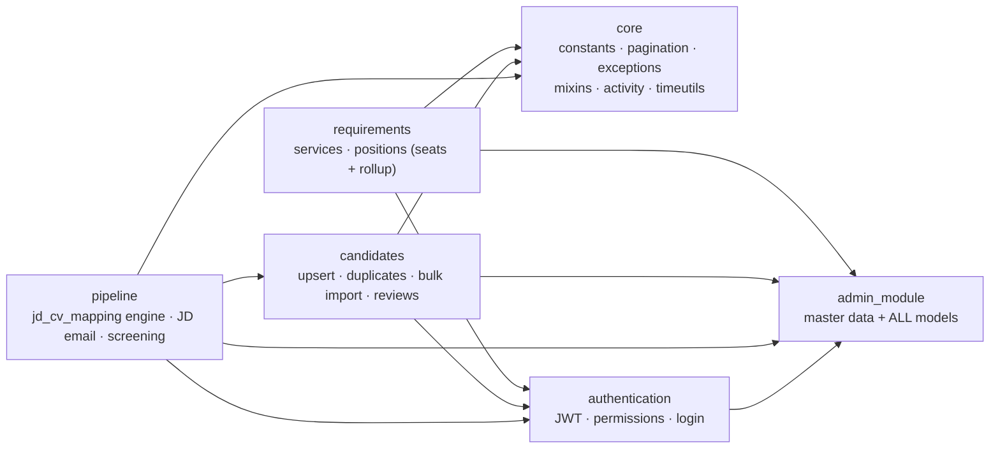
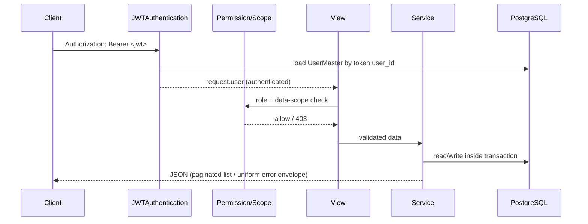

# Architecture

## Layered (clean) architecture
Requests flow through thin, single-responsibility layers:

```
URL Router → View/ViewSet (HTTP, auth, permission)
           → Serializer   (validation, shaping)
           → Service       (business logic, transactions)   ← rules live here
           → Model (ORM, managed=False)
           → PostgreSQL (schema: ats)
```

**Why a service layer?** Business rules (auto-numbering, duplicate logic, pipeline transitions) stay out of views/serializers so they are reusable and testable (SOLID – single responsibility). Views orchestrate; services decide.

**Why `managed = False`?** The database is owned/created by versioned SQL migrations (`database/migrations/`), not Django's migration engine. Models mirror the live schema. Apply changes with `python manage.py migrate_sql <file>`.

**Why centralized models?** All models live in `admin_module/models.py`. The tables are heavily cross-linked and `managed=False`; one data module avoids brittle cross-app string FKs. Domain *logic* is split into per-feature apps. Notable tables beyond the masters: `candidate_requirement_review` (the pre-pipeline **Review Pool** — explicit candidate↔requirement "under review" tags, separate from `jd_cv_mapping`), `bulk_import_batch` (one Excel upload — draft/pending/completed metadata, per-row report, rollback anchor), `requirement_position` (per-seat lifecycle) and `status_change_history` (unified requirement/position/application audit).

## 1. System Architecture


## 2. Module Architecture


## 3. API request flow


## Frontend (`frontend/`, implemented — F1)
React + TypeScript (Vite), Tailwind v3, shadcn-style UI primitives. The app is organised by **feature module**, not by page: each folder under `features/` owns its own `api.ts` (typed axios calls), page component, dialogs, columns, and types — so a feature's data access, UI, and shapes stay together.
```
frontend/src/
├── api/client.ts              # axios instance, JWT injection, 401 interceptor
├── auth/AuthContext.tsx       # session (localStorage), login/logout
├── routes/ProtectedRoute.tsx  # auth + role guard (role allow-list)
├── layouts/AppShell.tsx       # sidebar + topbar shell (Outlet host)
├── pages/LoginPage.tsx        # the only standalone page; the rest live in features/
├── components/ui/             # shadcn-style primitives (button, dialog, select, …)
├── components/                # shared (StatCard, DataTable, charts, form/* selects)
├── lib/                       # cn(), types, apiError, validation, status/workflow maps
└── features/
    ├── dashboard/     # api.ts · DashboardPage.tsx · types.ts
    ├── requirements/  # api.ts · RequirementsPage · RequirementDetailsPage · PositionsPanel
    │                  #   · RequirementFormDialog · AssignDialog · EndRecruitmentDialog · ExtendDateDialog
    ├── candidates/    # api.ts · CandidatesPage · CandidateDrawer · CandidateFormDialog
    │                  #   · VerifyProfileDialog · TagToRequirementDialog · BulkUploadDialog
    │                  #   · ImportHistoryDialog · UnmappedLocationsDialog · DuplicateReviewsPage
    ├── pipeline/      # api.ts · PipelinePage · StageBoard · JdTracker · JdComposeDialog
    │                  #   · ScreeningDialog · ReasonDialog · CommunicationsPanel
    └── admin/         # api.ts · MasterDataPage · ResourceManager · ResourceForm · config.ts
```
Routing (`App.tsx`): all pages are lazy-loaded and mount inside `AppShell` behind `ProtectedRoute`; `/admin` and `/duplicate-reviews` are nested behind a second `ProtectedRoute allow={["ADM"]}` guard. Auth flow: login → JWT in `localStorage` → axios `Authorization` header → role-based routing renders the matching views. CORS allows `http://localhost:5173`.

## Cross-cutting concerns
- **Position/seat lifecycle + status rollup (`requirements/positions.py`):** a Requirement owns N Positions (seats); this module is the *single write-path* for seat status and the `positions_open/positions_filled` cache. It derives the requirement's status from its seats (`recompute_requirement` → Assigned / Open / Partial Filled / Close Filled) and runs the requirement→seat cascade — `cascade_on_hold`/`cascade_on_cancel` (Open seats → Inactive), `cascade_on_resume`/`cascade_on_reopen` (auto-Inactive seats → Open), `cascade_on_end_recruitment` (withdraw remaining Open seats, status frozen). Manual (HM) Hold/Cancel and Filled seats are never auto-touched.
- **Activity feed (`core/activity.py`):** `log_activity(ActivityType, summary, …)` appends notable business events (`requirement_created/assigned/closed`, `candidate_added/joined`) to `activity_log` for the dashboard. Best-effort: an audit write never breaks the action that triggered it (failures are logged and swallowed). Used repo-wide from the service layer.
- **Datetime boundary (`core/timeutils.to_local_naive`):** the project runs `USE_TZ = False` on an IST server (naive local wall-clock). The React client sends instants as UTC (`toISOString()`), which DRF parses as naive-UTC. Every incoming datetime (screening schedule/reschedule, …) is normalized through `to_local_naive` before it is compared against `timezone.now()` or stored, so a genuinely-future time is never mistaken for the past.
- **Config:** `.env` via `python-dotenv`; no secrets in code.
- **Master-data CRUD contract:** `core.validation` (normalisation + per-field-kind format rules + `MASTER_RULES` registry) + a single `MasterDataViewSet` give every master identical behaviour — input cleaning, case-/space-insensitive dedupe, soft delete + referenced-guarded permanent delete, optimistic locking (`expected_updated_on`), and audit stamps. The frontend mirrors the rules in `lib/validation.ts` for instant inline feedback; the backend stays authoritative.
- **Errors:** `core.exceptions.custom_exception_handler` → `{success, status_code, error}`.
- **Pagination:** `core.pagination` (20/page, max 100) on all lists.
- **Audit:** `core.mixins.AuditModelMixin` auto-fills `created_by/on`, `updated_by/on`.
- **Logging:** console + rotating file (`backend/logs/ats.log`), logger `ats`.
- **API docs:** `drf-spectacular` → OpenAPI 3 (`/api/schema/`, `/api/docs/`, `/api/redoc/`).
- **Tests:** `pytest` + `pytest-django` (`backend/tests/`), reuse-DB + per-test rollback (managed=False).
- **Throttling:** `ScopedRateThrottle` on login (brute-force protection).
