# ER Diagram — Speegile ATS

Entity-relationship diagram of the **final implemented schema** (`ats`), generated
directly from the live PostgreSQL `information_schema`: **34 tables**, all primary
keys, and **all 110 foreign keys**. Verified consistent with the Django models
(`managed = False`) and `database/ats db schema.sql` — no drift. Crow's-Foot notation.

**Cardinality:** `||--o{` = parent **required** (NOT NULL FK) -> many children · 
`|o--o{` = parent **optional** (nullable FK) -> many children.

**Audit convention:** every table also has `created_by` and `updated_by` -> `user_master`
(48 audit FKs). These are listed as attributes but **not drawn as edges**, so the 62
domain relationships stay readable. Renderable images: `ER_DIAGRAM.png`, `ER_DIAGRAM.pdf`; source: `ER_DIAGRAM.mmd`.

```mermaid
erDiagram
  %% ===== Master / reference =====
  role_master {
    int role_id PK
  }
  user_master {
    int user_id PK
    int created_by FK
    int role_id FK
    int updated_by FK
  }
  client_master {
    int client_id PK
    int created_by FK
    int updated_by FK
  }
  client_manager_master {
    int client_mgr_id PK
    int client_id FK
    int created_by FK
    int updated_by FK
  }
  location_master {
    int location_id PK
    int created_by FK
    int updated_by FK
  }
  domain_master {
    int domain_id PK
    int created_by FK
    int updated_by FK
  }
  skill_master {
    int skill_id PK
    int created_by FK
    int domain_id FK
    int updated_by FK
  }
  priority_master {
    int priority_id PK
    int created_by FK
    int updated_by FK
  }
  req_type_master {
    int req_type_id PK
    int created_by FK
    int updated_by FK
  }
  notice_period_master {
    int np_id PK
    int created_by FK
    int updated_by FK
  }
  work_mode_master {
    int work_mode_id PK
    int created_by FK
    int updated_by FK
  }
  source_master {
    int source_id PK
    int created_by FK
    int updated_by FK
  }
  screening_mode_master {
    int screening_mode_id PK
    int created_by FK
    int updated_by FK
  }
  rejection_reason_master {
    int reason_id PK
    int created_by FK
    int updated_by FK
  }
  req_status_master {
    int status_id PK
    int created_by FK
    int updated_by FK
  }
  candidate_status_master {
    int candidate_status_id PK
    int created_by FK
    int updated_by FK
  }
  application_status_master {
    int application_status_id PK
    int created_by FK
    int updated_by FK
  }
  position_status_master {
    int position_status_id PK
    int created_by FK
    int updated_by FK
  }
  email_template_master {
    int template_id PK
    int created_by FK
    int updated_by FK
  }
  %% ===== Transaction (core) =====
  requirement_tracker {
    int req_id PK
    int client_id FK
    int client_mgr_id FK
    int created_by FK
    int hiring_mgr_id FK
    int location_id FK
    int np_id FK
    int priority_id FK
    int recruiter_id FK
    int recruitment_ended_by FK
    int req_status_id FK
    int req_type_id FK
    int skill1_id FK
    int skill2_id FK
    int skill3_id FK
    int updated_by FK
  }
  requirement_position {
    int position_id PK
    int created_by FK
    int filled_by_mapping_id FK
    int position_status_id FK
    int req_id FK
    int updated_by FK
  }
  candidate_master {
    int cv_id PK
    int candidate_status_id FK
    int created_by FK
    int current_location_id FK
    int duplicate_of_cv_id FK
    int import_batch_id FK
    int notice_period_id FK
    int preferred_location_id FK
    int profile_verified_by FK
    int source_id FK
    int updated_by FK
    int uploaded_by FK
    int work_mode_id FK
  }
  candidate_skill {
    int cs_id PK
    int cv_id FK
    int skill_id FK
  }
  candidate_requirement_review {
    int review_id PK
    int cv_id FK
    int req_id FK
    int resolved_by FK
    int tagged_by FK
  }
  %% ===== Mapping / pipeline =====
  jd_cv_mapping {
    int mapping_id PK
    int application_stage_id FK
    int closed_by FK
    int created_by FK
    int cv_id FK
    int latest_outcome_id FK
    int rejection_reason_id FK
    int req_id FK
    int screening_mode_id FK
    int updated_by FK
  }
  screening {
    int screening_id PK
    int created_by FK
    int mapping_id FK
    int screening_mode_id FK
    int updated_by FK
  }
  %% ===== Audit / log / import =====
  activity_log {
    int activity_id PK
    int actor_id FK
    int cv_id FK
    int req_id FK
  }
  status_change_history {
    int history_id PK
    int changed_by FK
  }
  candidate_profile_audit {
    int audit_id PK
    int changed_by FK
    int cv_id FK
  }
  candidate_interaction {
    int interaction_id PK
    int created_by FK
    int cv_id FK
    int req_id FK
  }
  communication_log {
    int comm_id PK
    int cv_id FK
    int req_id FK
    int sent_by FK
  }
  cv_document {
    int document_id PK
    int cv_id FK
    int uploaded_by FK
  }
  candidate_duplicate_review {
    int review_id PK
    int created_by FK
    int existing_cv_id FK
    int resolved_by FK
  }
  bulk_import_batch {
    int batch_id PK
    int requirement_id FK
    int source_id FK
    int uploaded_by FK
  }

  %% Relationships (created_by/updated_by -> user_master audit FKs omitted as edges; see note)
  role_master ||--o{ user_master : "role_id"
  client_master ||--o{ client_manager_master : "client_id"
  domain_master |o--o{ skill_master : "domain_id"
  client_master ||--o{ requirement_tracker : "client_id"
  client_manager_master |o--o{ requirement_tracker : "client_mgr_id"
  user_master |o--o{ requirement_tracker : "hiring_mgr_id"
  location_master |o--o{ requirement_tracker : "location_id"
  notice_period_master |o--o{ requirement_tracker : "np_id"
  priority_master |o--o{ requirement_tracker : "priority_id"
  user_master |o--o{ requirement_tracker : "recruiter_id"
  user_master |o--o{ requirement_tracker : "recruitment_ended_by"
  req_status_master ||--o{ requirement_tracker : "req_status_id"
  req_type_master ||--o{ requirement_tracker : "req_type_id"
  skill_master |o--o{ requirement_tracker : "skill1_id"
  skill_master |o--o{ requirement_tracker : "skill2_id"
  skill_master |o--o{ requirement_tracker : "skill3_id"
  jd_cv_mapping |o--o{ requirement_position : "filled_by_mapping_id"
  position_status_master |o--o{ requirement_position : "position_status_id"
  requirement_tracker ||--o{ requirement_position : "req_id"
  candidate_status_master |o--o{ candidate_master : "candidate_status_id"
  location_master |o--o{ candidate_master : "current_location_id"
  candidate_master |o--o{ candidate_master : "duplicate_of_cv_id"
  bulk_import_batch |o--o{ candidate_master : "import_batch_id"
  notice_period_master |o--o{ candidate_master : "notice_period_id"
  location_master |o--o{ candidate_master : "preferred_location_id"
  user_master |o--o{ candidate_master : "profile_verified_by"
  source_master |o--o{ candidate_master : "source_id"
  user_master ||--o{ candidate_master : "uploaded_by"
  work_mode_master |o--o{ candidate_master : "work_mode_id"
  candidate_master ||--o{ candidate_skill : "cv_id"
  skill_master ||--o{ candidate_skill : "skill_id"
  candidate_master ||--o{ candidate_requirement_review : "cv_id"
  requirement_tracker ||--o{ candidate_requirement_review : "req_id"
  user_master |o--o{ candidate_requirement_review : "resolved_by"
  user_master |o--o{ candidate_requirement_review : "tagged_by"
  application_status_master |o--o{ jd_cv_mapping : "application_stage_id"
  user_master |o--o{ jd_cv_mapping : "closed_by"
  candidate_master ||--o{ jd_cv_mapping : "cv_id"
  application_status_master |o--o{ jd_cv_mapping : "latest_outcome_id"
  rejection_reason_master |o--o{ jd_cv_mapping : "rejection_reason_id"
  requirement_tracker ||--o{ jd_cv_mapping : "req_id"
  screening_mode_master |o--o{ jd_cv_mapping : "screening_mode_id"
  jd_cv_mapping ||--o{ screening : "mapping_id"
  screening_mode_master ||--o{ screening : "screening_mode_id"
  user_master |o--o{ activity_log : "actor_id"
  candidate_master |o--o{ activity_log : "cv_id"
  requirement_tracker |o--o{ activity_log : "req_id"
  user_master |o--o{ status_change_history : "changed_by"
  user_master |o--o{ candidate_profile_audit : "changed_by"
  candidate_master ||--o{ candidate_profile_audit : "cv_id"
  candidate_master ||--o{ candidate_interaction : "cv_id"
  requirement_tracker |o--o{ candidate_interaction : "req_id"
  candidate_master ||--o{ communication_log : "cv_id"
  requirement_tracker |o--o{ communication_log : "req_id"
  user_master |o--o{ communication_log : "sent_by"
  candidate_master ||--o{ cv_document : "cv_id"
  user_master |o--o{ cv_document : "uploaded_by"
  candidate_master ||--o{ candidate_duplicate_review : "existing_cv_id"
  user_master |o--o{ candidate_duplicate_review : "resolved_by"
  requirement_tracker |o--o{ bulk_import_batch : "requirement_id"
  source_master |o--o{ bulk_import_batch : "source_id"
  user_master |o--o{ bulk_import_batch : "uploaded_by"
```

## FK verification (audited against `information_schema`)

**`bulk_import_batch`** (the pair to double-check):

| Column | References | Nullable |
|---|---|---|
| `requirement_id` | `requirement_tracker.req_id` | YES |
| `source_id` | `source_master.source_id` | YES |
| `uploaded_by` | `user_master.user_id` | YES |

So **`source_id` -> `source_master`** and **`uploaded_by` -> `user_master`** (not swapped).

**All FKs that reference `user_master`** (63 total):

- *Domain / user roles (drawn as edges):* `activity_log.actor_id`, `bulk_import_batch.uploaded_by`, `candidate_duplicate_review.resolved_by`, `candidate_master.profile_verified_by`, `candidate_master.uploaded_by`, `candidate_profile_audit.changed_by`, `candidate_requirement_review.resolved_by`, `candidate_requirement_review.tagged_by`, `communication_log.sent_by`, `cv_document.uploaded_by`, `jd_cv_mapping.closed_by`, `requirement_tracker.hiring_mgr_id`, `requirement_tracker.recruiter_id`, `requirement_tracker.recruitment_ended_by`, `status_change_history.changed_by`
- *Audit (attributes only, not drawn):* every table's `created_by` / `updated_by` — application_status_master, candidate_duplicate_review, candidate_interaction, candidate_master, candidate_status_master, client_manager_master, client_master, domain_master, email_template_master, jd_cv_mapping, location_master, notice_period_master, position_status_master, priority_master, rejection_reason_master, req_status_master, req_type_master, requirement_position, requirement_tracker, screening, screening_mode_master, skill_master, source_master, user_master, work_mode_master

## Table groups
- **Master / reference:** `role_master`, `user_master`, `client_master`, `client_manager_master`, `location_master`, `domain_master`, `skill_master`, `priority_master`, `req_type_master`, `notice_period_master`, `work_mode_master`, `source_master`, `screening_mode_master`, `rejection_reason_master`, `req_status_master`, `candidate_status_master`, `application_status_master`, `position_status_master`, `email_template_master`
- **Transaction (core):** `requirement_tracker`, `requirement_position`, `candidate_master`, `candidate_skill`, `candidate_requirement_review`
- **Mapping / pipeline:** `jd_cv_mapping`, `screening`
- **Audit / log / import:** `activity_log`, `status_change_history`, `candidate_profile_audit`, `candidate_interaction`, `communication_log`, `cv_document`, `candidate_duplicate_review`, `bulk_import_batch`

> Regenerate from the live DB whenever the schema changes so it never drifts from `ats db schema.sql`.
