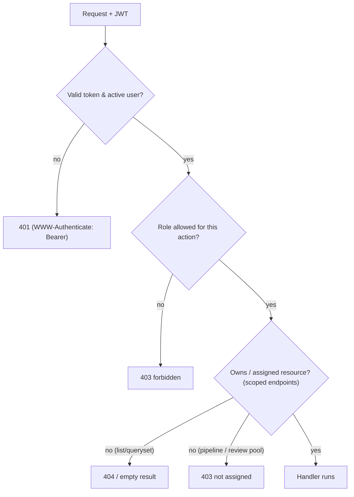

# Role-Based Access Control

## Roles
`ADM` Administrator · `HM` Hiring Manager · `REC` Recruiter — defined in `role_master`, referenced in code via `core.constants.Roles` (never literal strings).

## Mechanism
- **AuthN:** `authentication.jwt_authentication.JWTAuthentication` decodes the JWT and attaches a `UserMaster` (with `is_authenticated` property) to `request.user`. It also implements `authenticate_header()` → returns `"Bearer"`, so DRF has a `WWW-Authenticate` header and any auth failure (missing / malformed / expired / invalid token, unknown or inactive user) returns **401**, not 403. The frontend's axios interceptor treats 401 as "session gone → bounce to login".
- **AuthZ:** permission classes in `authentication/permissions.py` compare `user.role.role_code`:
  - `IsAdministrator` — role == ADM.
  - `IsRecruiter` — role == REC.
  - `IsHiringManager` — role == HM.
  - `IsHiringManagerOrAdmin` — HM or ADM.
  - `IsRecruiterOrAdmin` — REC or ADM.
  - `IsAdminOrReadOnly` — any authenticated user may read (SAFE methods); only ADM may write. Base class for all master/reference data.
  - `CanManageReferenceData` — read = any authenticated user; **POST/create = ADM or HM** (inline creation of a missing skill/location from a workflow form); PUT/PATCH/DELETE (edit + soft/permanent delete) = **ADM only**. Applied on `SkillMasterViewSet` and `LocationMasterViewSet`.
- **Data scoping:** beyond role checks, many endpoints restrict by ownership (recruiter → assigned requirements; HM → owned requirements). Enforced in `get_queryset()` / `get_object()` and in services (not the UI).

## Permission matrix (current)
| Endpoint group | ADM | HM | REC | Anonymous |
|----------------|-----|----|----|-----------|
| `POST /auth/login` | ✓ | ✓ | ✓ | ✓ (AllowAny + `login` throttle) |
| `/api/users/` (UserMasterViewSet) — read & write | ✓ | ✗ | ✗ | ✗ |
| Other master data — read | ✓ | ✓ | ✓ | ✗ |
| Other master data — write | ✓ | ✗ | ✗ | ✗ |
| Reference data (Skills, Locations) — read | ✓ | ✓ | ✓ | ✗ |
| Reference data (Skills, Locations) — create (POST) | ✓ | ✓ | ✗ | ✗ |
| Reference data (Skills, Locations) — edit / delete | ✓ | ✗ | ✗ | ✗ |
| Requirements — read (list/retrieve/positions/status-history) | ✓ | ✓ (owned) | ✓ (assigned) | ✗ |
| Requirements — create / destroy / add-positions / delete-position | ✓ | ✓ | ✗ | ✗ |
| Requirements — update / partial_update / set-status | ✗ | ✓ | ✗ | ✗ |
| Requirements — set-position-status / end-recruitment | ✗ | ✓ | ✗ | ✗ |
| Requirements — assign (recruiter) | ✓ | ✗ | ✗ | ✗ |
| Candidates — read | ✓ | ✓ (restricted view) | ✓ | ✗ |
| Candidates — create / update / bulk-preview / bulk-upload / set-status / verify-profile / tag-requirements / untag-requirement / reconcile-location | ✓ | ✗ | ✓ | ✗ |
| Candidates — clear-status (remove Fake/Blacklist) | ✓ | ✗ | ✗ | ✗ |
| DuplicateReview — create | ✓ | ✗ | ✓ | ✗ |
| DuplicateReview — list / retrieve / resolve | ✓ | ✗ | ✗ | ✗ |
| ImportBatch — read / report / rollback | ✓ | ✗ | ✓ (own uploads) | ✗ |
| ImportBatch — mark-failed | ✓ | ✗ | ✗ | ✗ |
| Pipeline — all endpoints (below) | ✓ | ✗ | ✓ (assigned only) | ✗ |

Notes:
- **Requirements** — the split is deliberate (see `RequirementViewSet.get_permissions`): **assign = Admin only** (HM/REC → 403); **update/partial_update + lifecycle `set-status` + `set-position-status` + `end-recruitment` = Hiring Manager only** (Admin excluded — Hold/Cancel/Close-Lost and End Recruitment are the HM's decision); **create/destroy/add-positions/delete-position = HM or Admin**; **read = any authenticated user** (scoped by `get_queryset`).
- **`/api/users/`** is carved out of the "any authenticated user may read master data" rule: `UserMasterViewSet.permission_classes = [IsAdministrator]` (staff PII — email/mobile/username/role), so recruiters/HMs cannot even list/retrieve users. The one non-admin user-picking flow (recruiter assignment) is itself Admin-only.
- The login endpoint is rate-limited (`ScopedRateThrottle`, scope `login`).
- **User create/update** goes through `UserWriteSerializer`: password is write-only, hashed with `make_password`, never returned, and validated against the configured `AUTH_PASSWORD_VALIDATORS` (`validate_password`) on every create and on any update that supplies a new password.

## Data-scoping rules
- **Requirement lists & detail (role-scoped):** `RequirementViewSet.get_queryset()` — Admin sees all; Recruiter sees only `recruiter_id == user`; HM sees only `hiring_mgr_id == user`; unknown role → none. Because it also backs `get_object()`, a recruiter hitting another recruiter's requirement by id gets **404** (not their data). Dashboard/deep-link filters (`?status=`, `?missing=recruiter|hm`) are applied server-side on top.
- **Candidate database visibility (backend-enforced):** `CandidateViewSet.get_queryset()` — Hiring Managers get a read-only sourcing view limited to `HM_VISIBLE` statuses (New_CV, Talent Pool) plus candidates mapped to a requirement they own. List views for REC/ADM hide `DB_DEFAULT_HIDDEN` statuses by default (a `?status=ALL`/`?status=<code>` overrides); a specific candidate stays reachable by id for detail actions. `?requirement=<id>` is checked for accessibility per role (`_requirement_accessible`) — an inaccessible id yields no rows.
- **Review-Pool tag/untag authorization (`candidates/views.py _authorize_review_pool`):** only the requirement's **assigned recruiter** (or an Admin) may add/remove a candidate to/from a requirement's Review Pool → otherwise `403`. Enforced on `tag-requirements`, `untag-requirement`, on manual candidate create when a `requirement` is supplied, and on bulk import when a `requirement` is supplied.
- **ImportBatch ownership:** recruiters see only their own uploads (`get_queryset` filters `uploaded_by`); `rollback` and confirming a preview draft are allowed for an Admin or the uploading recruiter only.
- **Pipeline recruiter ownership (`pipeline/views.py _get_requirement_for_recruiter`):** every pipeline endpoint requires `requirement.recruiter_id == request.user.user_id` (Admin bypasses) → `403 "not assigned to you"`. Action endpoints additionally require the requirement to be workable (`require_workable=True`): recruitment-ended, expired, or non-`WORKABLE` status all block writes (reads are never blocked). The full IsRecruiterOrAdmin + assigned-recruiter set:
  - `GET  /api/pipeline/new-cvs/?requirement=<id>` — review-pool / New_CV candidates ranked by skill match.
  - `POST /api/pipeline/review/` — Shortlist / Not Suitable review decision.
  - `GET  /api/pipeline/mappings/?requirement=<id>` — pipeline rows.
  - `GET  /api/pipeline/mappings/<id>/timeline/` — one application's timeline.
  - `POST /api/pipeline/jd-preview/` · `POST /api/pipeline/send-jd/` · `GET /api/pipeline/communications/?requirement=<id>` — JD email preview / send / tracker.
  - `POST /api/pipeline/transition/` — bulk stage transition.
  - `POST /api/pipeline/outcome/` — record a stage outcome (advance or close).
  - `POST /api/pipeline/advance/` — advance a stage via an action.
  - `POST /api/pipeline/reschedule/` — reschedule a scheduled screening.
  - `GET/POST /api/pipeline/screenings/` · `POST /api/pipeline/screenings/<id>/complete/` · `POST /api/pipeline/screenings/<id>/reschedule/` — screening rounds.
- **Dashboard KPI scoping (`admin_module.dashboard_service.build_dashboard`):** Admin → global KPIs + per-recruiter workload monitoring; Hiring Manager → their owned requirements; Recruiter → their own requirements/mappings/positions and their own active Review Pool ("candidates available"). `ProfileView` is Admin-only.

## Expiry & End-Recruitment (requirement read-only rules)
Expiry is a derived overlay (Target Fill Date passed while non-terminal — `requirements.services.requirement_is_expired`), never a stored status.
- While **expired**, a requirement is read-only **except `target_fill_date`** (extending it clears the overlay): `RequirementViewSet.update()` rejects any other field; `set-status`, `set-position-status`, and `add-positions` are blocked. Editing is HM-only in any case.
- **End Recruitment** (`POST /api/requirements/{id}/end-recruitment/`, **IsHiringManager only**) permanently stops recruiting the remaining seats of an expired, partially-filled requirement — closes still-active applications as "Positions Withdrawn", returns those candidates to the Talent Pool, leaves the requirement PARTIAL_FILLED + Expired. Once `recruitment_ended`, the requirement is permanently read-only and pipeline actions are refused.

## Implementation status
List-view role scoping and object-level requirement checks are **implemented** (via `RequirementViewSet.get_queryset()`/`get_object()`, `CandidateViewSet.get_queryset()`, and the pipeline/review-pool ownership helpers) — no outstanding RBAC work is tracked here.
