# Workflow, Sequence & State Diagrams

## Recruitment workflow (end to end)
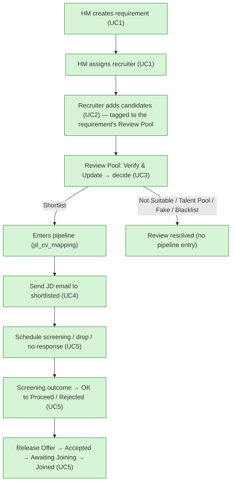

Two membership concepts are kept **separate** throughout:
- **Review Pool** (`candidate_requirement_review`, status `ACTIVE`) — the candidate is *under review* for a requirement. Membership is the **explicit tag**, never skill matching.
- **Pipeline** (`jd_cv_mapping`) — the candidate has *entered* the pipeline (only ever via **Shortlist**).

## UC1 — Create & assign requirement
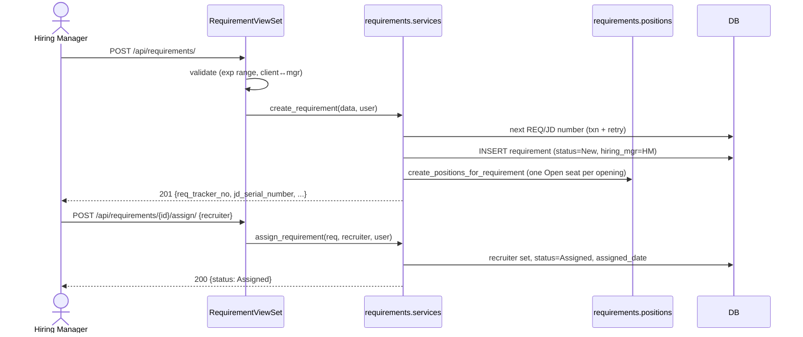

## UC2 — Candidate create / duplicate logic (+ Review Pool tagging)
`upsert_candidate` is the single create/update path (manual form, bulk import, Verify & Update). Passing a `requirement` also **tags the candidate into that requirement's Review Pool** as a side effect (never a `jd_cv_mapping`).
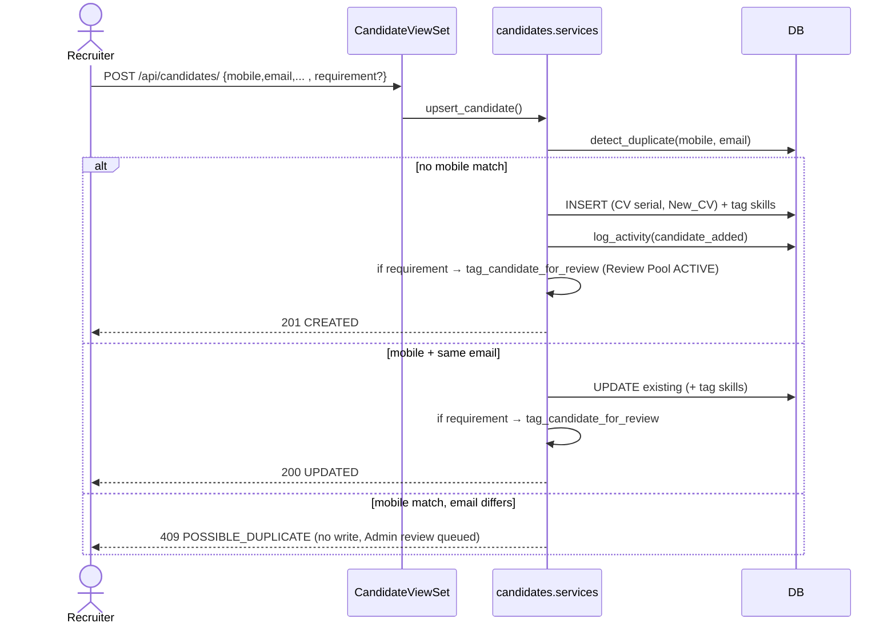

## UC3 — Review Pool + the two decision paths
The Review Pool for a requirement = candidates **explicitly tagged** `ACTIVE` in `candidate_requirement_review` (minus those already mapped / Fake / Blacklisted). Skill overlap is used **only to rank** within that set (`matched_skills`, best first), never for membership.

There are **two live decision endpoints**:
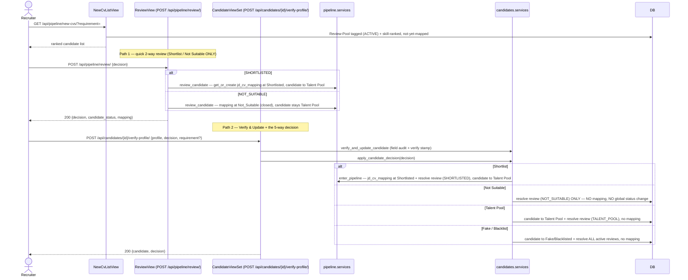
Key rule: **Not Suitable does NOT create a `jd_cv_mapping` and does NOT change the candidate's global status** — it only resolves the pre-pipeline review association.

## Review Pool tagging / untagging
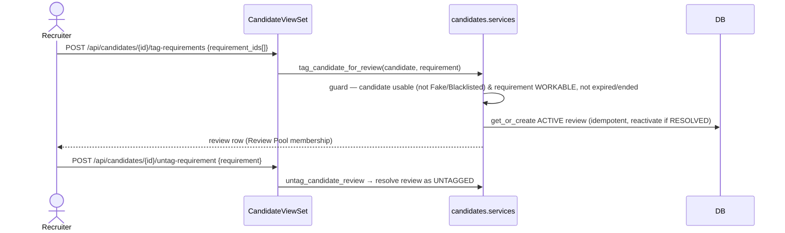

## Requirement lifecycle (state)
Auto rollup (`recompute_requirement`) derives **Assigned / Open / Partial Filled / Close Filled** from the seats; manual HM actions drive **Hold / Cancelled / Close Lost**. **Expired is NOT a stored state** — it is a derived, read-only overlay (`requirement_is_expired`: Target Fill Date passed while non-terminal) that clears the moment the date is extended.
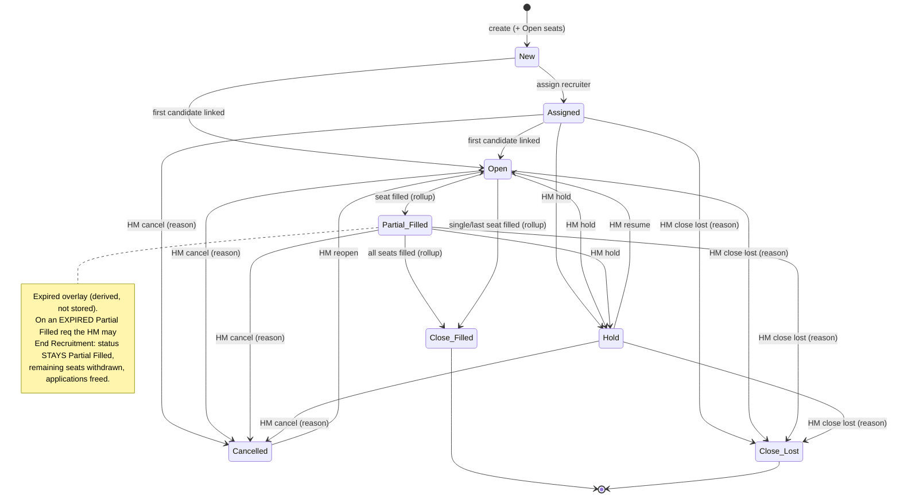
Hold/Cancel/Close-Lost are allowed from any active state (Assigned / Open / Partial Filled) and from Hold. Cancelled is reopenable (→ Open); Close Lost is terminal.

## Requirement Hold / Cancel / Reopen + closure cascade
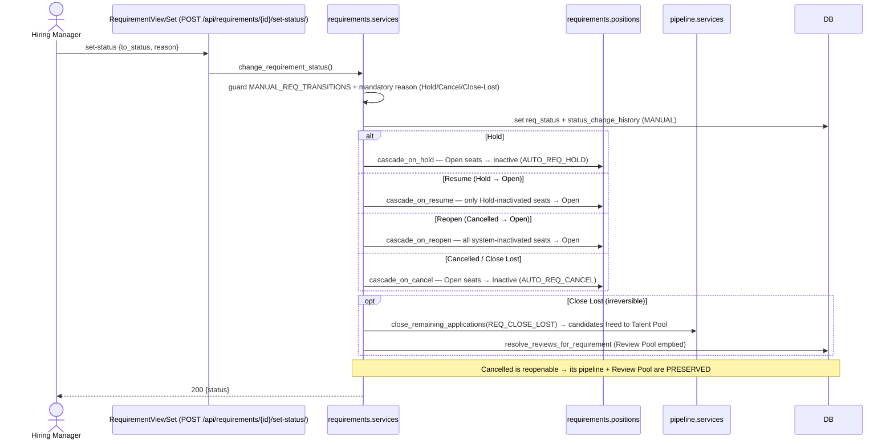

## Requirement End Recruitment (expired, partially filled)
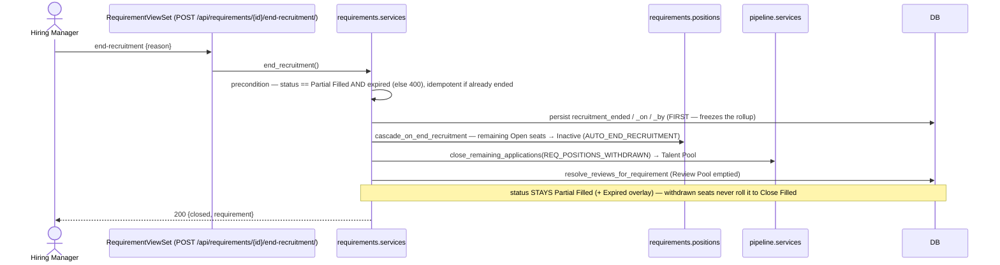

## Candidate global status (state)
A per-requirement decision never changes the global status; only the automation below does. **Not Suitable causes NO status change.** Fake/Blacklisted are hard and never overridden.
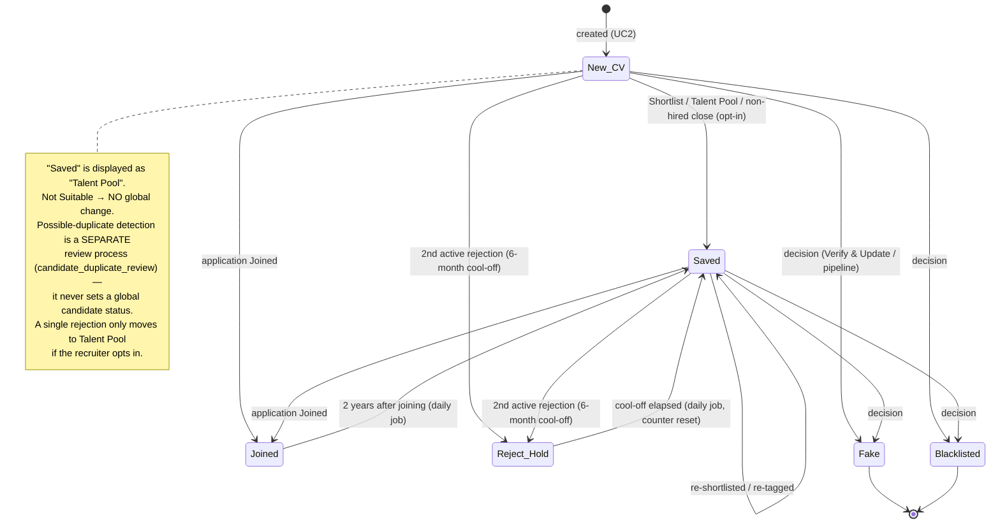

## Per-requirement pipeline (jd_cv_mapping) — stage × outcome engine
`application_stage` holds the STAGE; `latest_outcome` holds the last OUTCOME; `is_closed` marks a terminal close. Advancing ACTIONS (solid) are side-effecting buttons; closing OUTCOMES (dashed) end the application and drive the candidate's global status via `apply_application_outcome`.
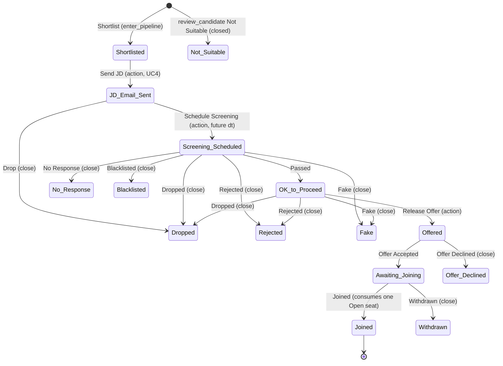
Joining consumes one Open seat (`_consume_open_position`, over-fill safe with `select_for_update(skip_locked)`); filling the last seat triggers the requirement `Close Filled` rollup, which auto-closes the remaining applications back to the Talent Pool.

## Screening schedule / reschedule / complete
Screenings are separate rounds on an application; every incoming datetime is normalized with `to_local_naive` and must be in the future.
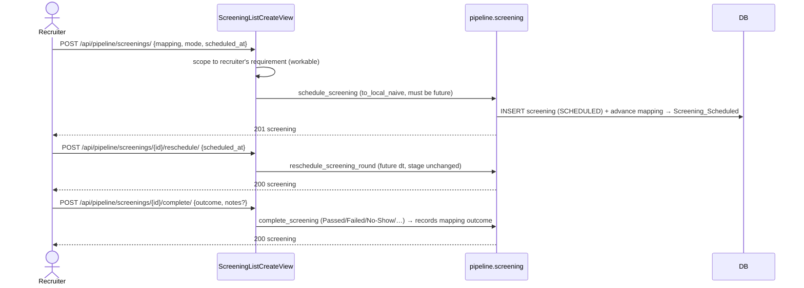

## Bulk import — preview → confirm → rollback
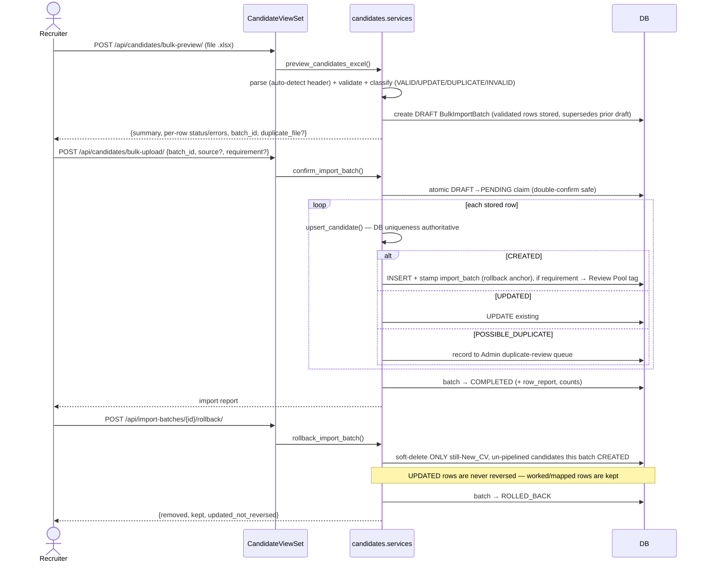
Recovery: a PENDING batch whose process died is swept to FAILED (`fail_stale_import_batches`), and DRAFTs past their TTL are purged — both in the daily maintenance job.
